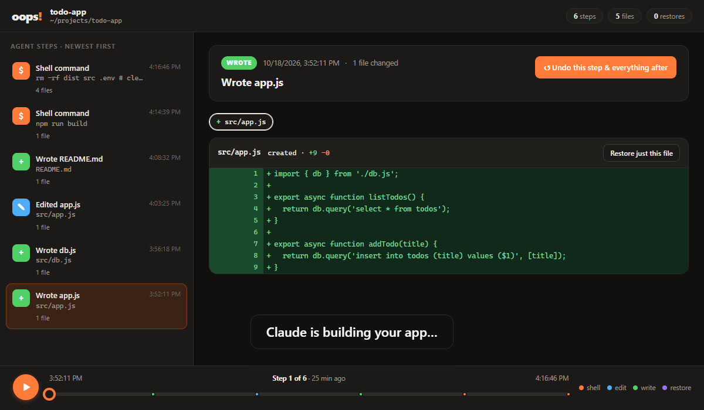
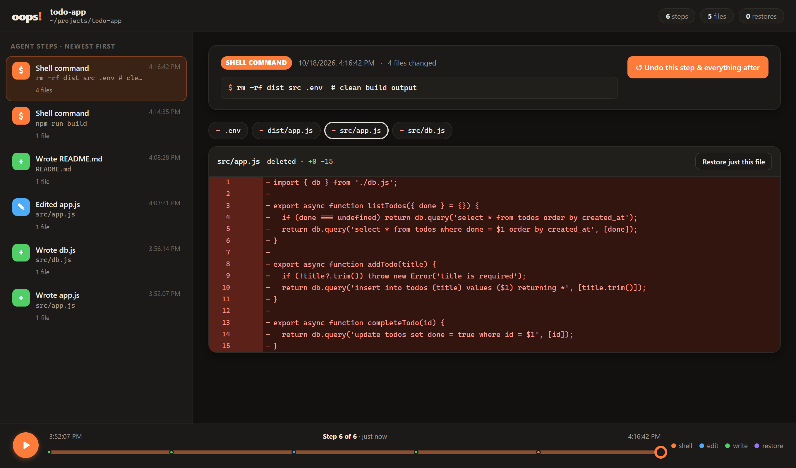
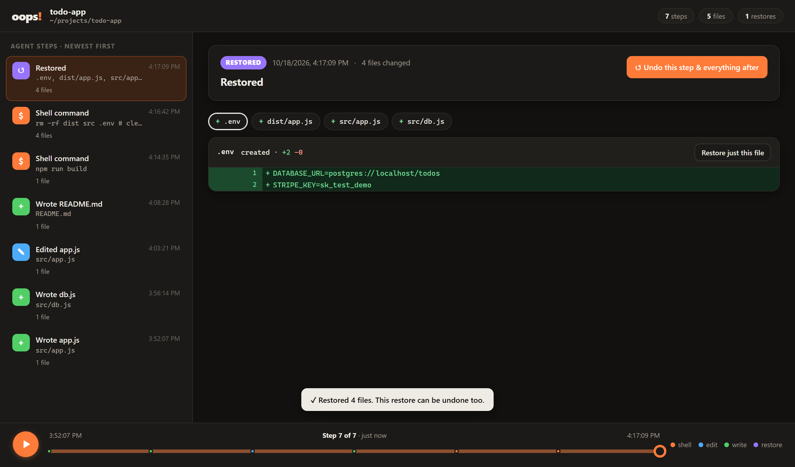
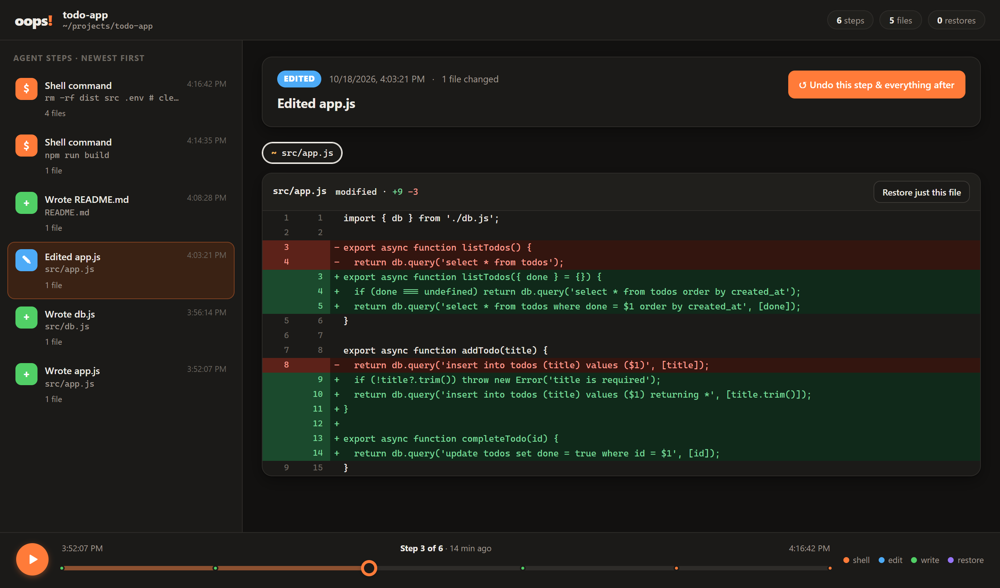

<div align="center">

# oops!

### Undo anything your AI agent did. Even `rm -rf`.

A Claude Code plugin that snapshots your files before every edit **and every shell command**,<br>
with a visual timeline to scrub back through and restore from.

[](https://github.com/theturuk/oops-agent/actions/workflows/test.yml)




</div>

---

> [!WARNING]
> **Alpha.** Early and experimental, built in public. It's tested end-to-end with Claude Code on Windows and runs automated tests on Windows, macOS and Linux, but don't make it your only backup yet. Bug reports are very welcome.

## The problem

You ask your agent to "clean up the build folder". It runs:

```bash
rm -rf dist src .env   # clean build output
```

Your source code and your `.env` are gone. You press `Esc Esc` to open Claude Code's `/rewind`… and nothing comes back. That's documented behavior:

> *"Checkpointing does not track files modified by Bash commands."*
> — [Claude Code docs, Checkpointing](https://code.claude.com/docs/en/checkpointing#bash-command-changes-not-tracked)

`git` won't save you either if the work wasn't committed, or if the file was in `.gitignore` (like `.env`).

## The fix



Oops was watching. Every file that command deleted is in the timeline, contents and all. Click **Undo this step**:



All four files are back. The restore is a step of its own, so you can undo the undo.

## Oops vs. Claude Code's `/rewind`

`/rewind` is great for what it does: it rewinds the conversation and the edits Claude made with its file tools. Oops is built for everything it can't see.

| | Claude Code `/rewind` | **Oops** |
|---|:---:|:---:|
| Edits made with Claude's Write / Edit tools | ✅ | ✅ |
| Files changed by **Bash** commands (`rm`, `mv`, `cp`, `sed -i`, scripts…) | ❌ | ✅ |
| Files changed by **PowerShell** commands on Windows | ❌ | ✅ |
| Edits made by **subagents** | ❌ mostly not restored | ✅ hooks run inside subagents too |
| Changes you made **by hand** in between | ❌ | ✅ shown as "outside change" |
| Restore **a single file** | ❌ whole checkpoint | ✅ |
| **Visual timeline** with a diff of every step, to scrub and play | ❌ | ✅ |
| Undo a restore | — | ✅ |
| Rewinds the **conversation** too | ✅ | ❌ (files only) |
| History kept for | ~30 days, per session | until you delete it, per project |

Sources for the `/rewind` column: [Checkpointing → Limitations](https://code.claude.com/docs/en/checkpointing#limitations).

**Use both.** `/rewind` to take the conversation back, Oops to get the files back.

## Install

You need [Claude Code](https://code.claude.com) and [Node.js](https://nodejs.org) 18 or newer.

```
/plugin marketplace add theturuk/oops-agent
/plugin install oops-agent@oops-agent
```

Restart Claude Code. That's it: from now on, every change Claude makes is recorded.

## Use

| In Claude Code, type… | What happens |
|---|---|
| `/oops-agent:oops` | Opens the timeline in your browser |
| `/oops-agent:oops undo` | Reverts the last step (run it again to redo) |
| `/oops-agent:oops log` | Lists the recorded steps |
| *"oops, bring back the config file you deleted"* | Claude finds the right step and restores it |



**In the timeline:** click a step on the left (or drag the scrubber, or use ← →) to see exactly what changed. Press ▶ / space to watch your project change step by step. Then:

- **Undo this step & everything after**: every file goes back to how it was right before that step.
- **Restore just this file**: only the file you're looking at goes back.

Both ask for a second click to confirm.

<details>
<summary>Command line</summary>

```bash
node <plugin-dir>/scripts/oops.js log                 # list steps
node <plugin-dir>/scripts/oops.js show <step-id>      # files changed in one step
node <plugin-dir>/scripts/oops.js undo                # revert the last step
node <plugin-dir>/scripts/oops.js restore <step-id> [--file path] [--after]
node <plugin-dir>/scripts/oops.js ui                  # open the timeline
```

Run from inside your project, or pass `--root <dir>`.
</details>

## How it works

```
Claude wants to run a tool (Write / Edit / Bash / PowerShell)
   │
   ├─ PreToolUse hook   → snapshot the file it will edit (for shell commands: the whole project)
   ├─ the tool runs
   └─ PostToolUse hook  → snapshot again, record only what actually changed
```

- **Shell commands can touch anything**, so Oops snapshots the whole project before each one. A stat cache means only files whose size or modification time changed are re-read, so after the first run this is fast.
- **Storage is content-addressed and gzip-compressed.** A file that didn't change is stored once, however many snapshots include it.
- **Snapshots live in `~/.oops-agent`, outside your project.** `rm -rf .` can't take your undo history with it.
- **Hooks never block Claude.** If anything goes wrong, Oops logs it and gets out of the way.
- **Local only.** No server, no account, no API calls, no tokens spent. Zero dependencies, just Node's standard library.

## Limitations

Being honest about what an alpha does and doesn't do:

- **Skipped folders:** `.git`, `node_modules`, `.venv`, `venv`, `__pycache__`, `target`, `.next` and a few other caches. Add your own (one name per line) in a `.oopsignore` file in the project root.
- **Large files:** files over 20 MB are skipped (change with `OOPS_MAX_FILE_MB`).
- **Files outside the project** are tracked when Claude edits them with Write/Edit, but not when a shell command touches them.
- **No automatic cleanup yet.** Old snapshots stay in `~/.oops-agent` until you delete that folder.
- **Secrets:** snapshots are stored unencrypted in your home folder, including files like `.env`. Protect `~/.oops-agent` like you protect your project.
- **The plugin must be on.** `claude --plugin-dir` applies to one launch only, so a later `claude --resume` runs without it. Install it with `/plugin install` to keep it on.
- **Claude Code only, for now.** Cursor and Codex support is planned.

**Oops doesn't replace git.** Commit your work. Oops is the safety net for everything in between.

## Development

```bash
git clone https://github.com/theturuk/oops-agent
cd oops-agent
node test/smoke.js          # end-to-end tests
claude --plugin-dir .       # run Claude Code with your local copy
```

Issues and PRs welcome.

## License

[MIT](LICENSE)
